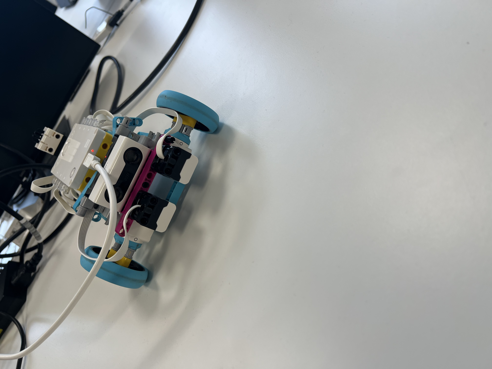
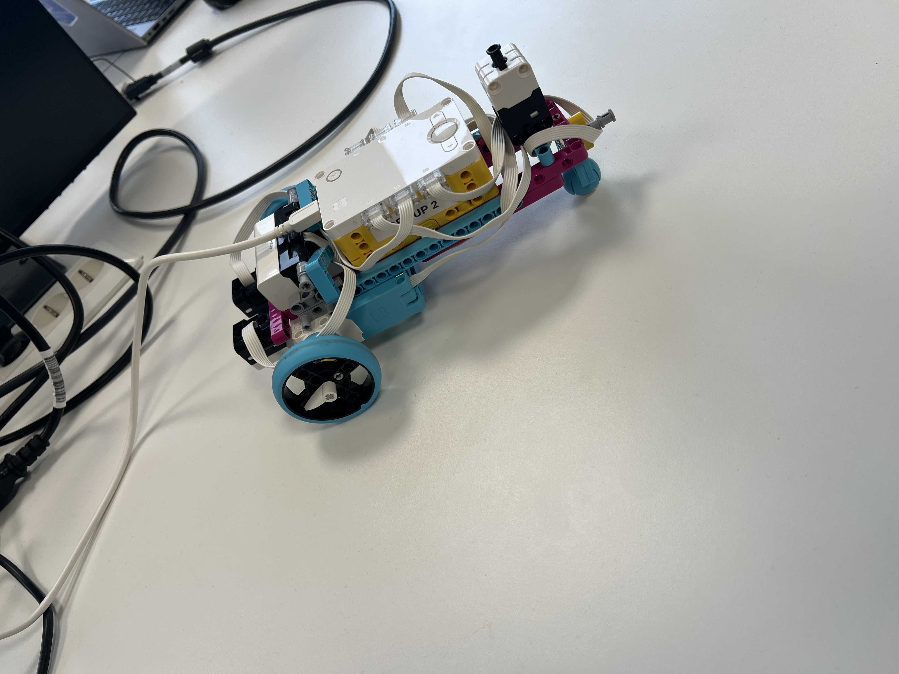
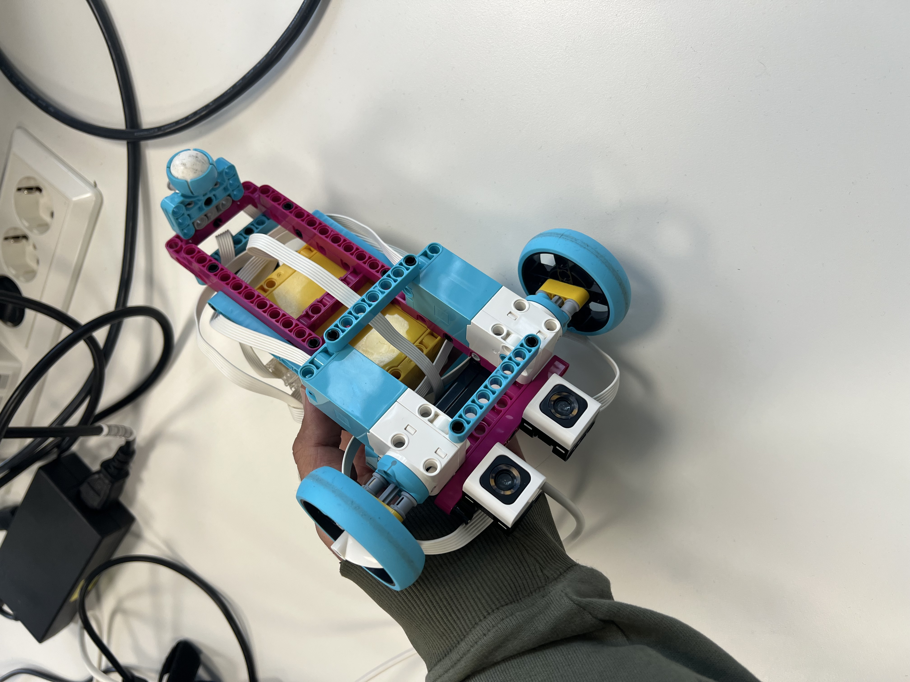
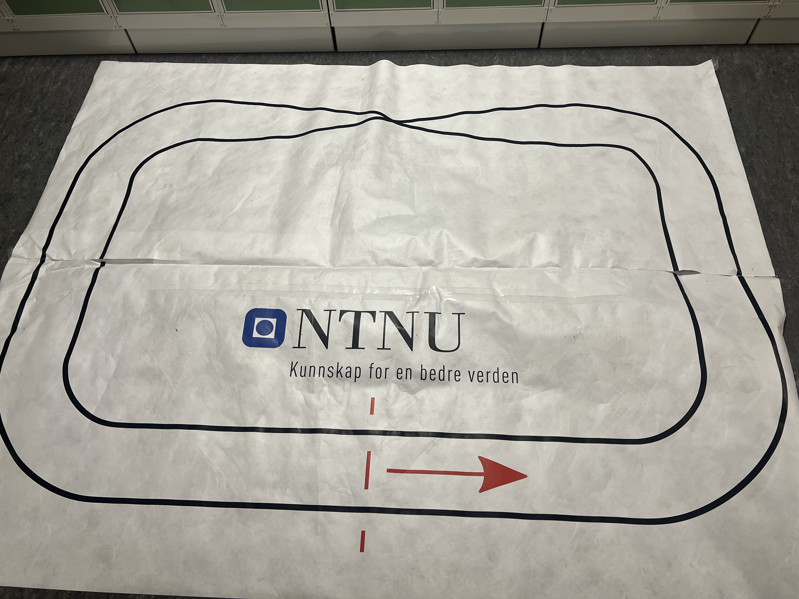

# LEGO SPIKE Prime – Robotnavigasjon med Python

## Prosjektbeskrivelse

Dette prosjektet ble gjennomført som en del av dataingeniørstudiet ved NTNU i Gjøvik.

Formålet var å programmere en LEGO SPIKE Prime-robot ved hjelp av Python, med fokus på sensorbasert navigasjon, motorstyring og automatiserte handlinger.

Prosjektet ga praktisk erfaring med programmering av fysiske systemer og samspillet mellom programvare, sensorer og motorer.

## Teknologier og komponenter

- **Programmeringsspråk:** Python
- **Robotplattform:** LEGO SPIKE Prime
- **Motorer:** To motorer tilkoblet port A og B
- **Fargesensorer:** To sensorer tilkoblet port C og D
- **Avstandssensor:** Tilkoblet port F
- **Andre funksjoner:** Lydsignaler og lysmatrise

## Funksjonalitet

### Sensorbasert navigasjon

Roboten benytter to fargesensorer for å registrere lysrefleksjon fra underlaget. Sensorverdiene sammenlignes med en definert grenseverdi for å styre robotens bevegelser.

### Hinderdeteksjon

En avstandssensor registrerer hindringer foran roboten. Når en hindring registreres innenfor den programmerte avstanden, stopper roboten og aktiverer lyd- og lyssignaler.

### Motorstyring

Motorene styres individuelt gjennom et motorpar. Ved å justere motorhastighetene kan roboten kjøre fremover og utføre svingbevegelser.

### Automatiserte aktiviteter

Programmet benytter en tidsbasert teller for å aktivere tilfeldige handlinger. Disse inkluderer lydsignaler, tekstvisning, motorbevegelser og symboler på lysmatrisen.

## Programmeringskonsepter

Prosjektet omfatter:

- Variabler og datatyper
- Betingelser og logiske uttrykk
- Løkker
- Asynkrone funksjoner
- Sensoravlesning
- Motorstyring
- Tilfeldige handlinger

## Faglig læringsutbytte

Gjennom prosjektet fikk jeg praktisk erfaring med hvordan Python kan brukes til å styre en fysisk robot.

Arbeidet ga økt forståelse av hvordan sensorverdier behandles i programkode og brukes til å kontrollere motorer og automatiserte handlinger.

Prosjektet bidro også til å utvikle ferdigheter innen programmering, testing og teknisk problemløsning.

## Prosjektstatus

Oppgaven er levert og godkjent av faglæreren.

Originalkoden er bevart uten endringer og dokumenterer det opprinnelige prosjektarbeidet.

## Prosjektfiler

Dette repositoryet inneholder to Python-programmer utviklet for LEGO SPIKE Prime som en del av praktisk prosjektarbeid ved NTNU i Gjøvik.

### Oppgave3.py – Sensorbasert robotnavigasjon

Programmet bruker to fargesensorer til å registrere lysrefleksjon fra underlaget og styre robotens bevegelser.

En avstandssensor registrerer hindringer, mens motorstyringen tilpasses sensorverdiene. Programmet inneholder også automatiserte aktiviteter som lydsignaler, tekstvisning og motorbevegelser.

**Sentrale programmeringskonsepter:** Løkker, betingelser, variabler, asynkron programmering og sensorbasert styring.

### Prosjekt 2 Gruppe 2.py – Hinderdeteksjon og motorstyring

Programmet styrer en LEGO SPIKE Prime-robot ved hjelp av motorer, trykksensor og avstandssensor.

Roboten starter etter aktivering av trykksensoren og bruker avstandsmålinger til å registrere hindringer. Programmet inneholder logikk for unnamanøvrering, telling av hindringer og varsling gjennom lyd og lysmatrise.

**Sentrale programmeringskonsepter:** Betingelser, løkker, tellere, asynkrone funksjoner og motorstyring.

## Dokumentasjon og originalkode

Begge Python-filene er bevart i sin opprinnelige form fra det innleverte prosjektarbeidet.

Prosjektbeskrivelsene dokumenterer programmets oppbygning, sentrale funksjoner og relevante programmeringskonsepter.

## Robotkonstruksjon og bildedokumentasjon

Bildene nedenfor dokumenterer LEGO SPIKE Prime-robotens fysiske konstruksjon, plasseringen av sentrale komponenter og sensoroppsettet som ble benyttet i prosjektarbeidet.

### Robotens front og sensorer

*Figur 1: Robotens front med hjul, sensorer og tilhørende mekanisk konstruksjon.*

### Robotens konstruksjon sett fra siden

*Figur 2: Sidevisning av roboten som viser hjulplassering, kontrollenhet og kabelføring.*

### Robotens mekaniske oppbygning

*Figur 3: Robotens mekaniske konstruksjon og sensorplassering under håndtering.*

Bildedokumentasjonen gir en visuell oversikt over hvordan robotens mekaniske og elektroniske komponenter er satt sammen.

## Testbane og linjefølging

I prosjektet ble det benyttet en testbane med en svart linje på et lyst underlag. Roboten var programmert til å registrere lysrefleksjon ved hjelp av to fargesensorer og tilpasse motorstyringen for å følge banen.

### NTNU-testbane

*Figur 4: Testbane med svart linje som ble benyttet til utvikling og utprøving av robotens linjefølgingsfunksjon.*

## Linjefølging – Python-program

Filen `Linjefolging_NTNU.py` inneholder et program for sensorbasert navigasjon med LEGO SPIKE Prime.

Programmet benytter to fargesensorer, tilkoblet port C og D, til å måle lysrefleksjonen fra underlaget. En grenseverdi på 35 brukes for å skille mellom lyse og mørke områder.

Basert på sensorverdiene justerer programmet hastigheten til de to motorene, som er tilkoblet port A og B.

### Styringslogikk

- Når begge sensorene registrerer lyst underlag, kjører roboten fremover.
- Når venstre sensor registrerer svart, utfører programmet en venstrekorreksjon.
- Når høyre sensor registrerer svart, utfører programmet en høyrekorreksjon.
- Når begge sensorene registrerer svart, benytter programmet den sist registrerte styringsretningen som del av håndteringen av et mulig kryss.

### Programmeringskonsepter

Programmet demonstrerer bruk av betingelser, løkker, variabler, asynkron programmering og sensorbasert motorstyring.

Koden dokumenterer arbeidet med å utvikle en robot som kan navigere etter en svart linje på NTNU-testbanen.
